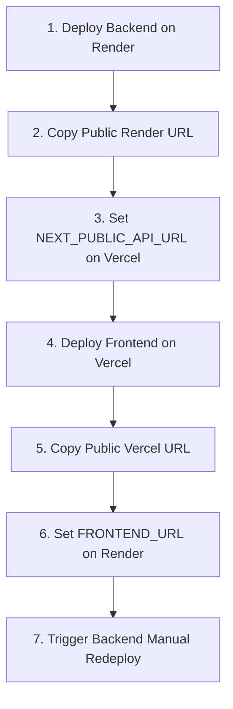

# GearUp Production Deployment Guide

This guide provides the exact click-by-click instructions for deploying the **Backend to Render** and the **Frontend to Vercel**, including the critical environment linking order.

---

## Deployment Sequence (Follow Strictly)



---

## Step 1: Deploy Backend to Render

1. Log into your [Render Dashboard](https://dashboard.render.com/).
2. Click **New +** and select **Web Service**.
3. Connect your backend GitHub repository (or choose public repo URL).
4. Configure the service settings:
   - **Name**: `gearup-backend`
   - **Region**: Choose the region closest to your Neon DB (e.g. Frankfurt / Oregon / Singapore).
   - **Root Directory**: `backend` (if in monorepo) or leave blank if backend repository root.
   - **Runtime**: `Node`
   - **Build Command**:
     ```bash
     npm install --include=dev && npx prisma generate && npx prisma migrate deploy && npm run build
     ```
   - **Start Command**:
     ```bash
     npm start
     ```
   - **Plan**: Free
5. Open **Advanced** > **Health Check Path** and set it to:
   ```
   /health
   ```
6. Under **Environment Variables**, add:
   - `NODE_ENV`: `production`
   - `PORT`: `10000`
   - `DATABASE_URL`: *(Your Neon PostgreSQL pooled connection string)*
   - `DIRECT_URL`: *(Your Neon PostgreSQL direct connection string)*
   - `JWT_SECRET`: *(A secure random 32+ character string)*
   - `JWT_EXPIRES_IN`: `7d`
   - `BACKEND_URL`: *(Leave empty or set to temporary value, update once created)*
   - `FRONTEND_URL`: `http://localhost:3000` *(Temporary until Vercel URL is generated)*
   - `APP_URL`: `http://localhost:3000`
   - `SSLCOMMERZ_STORE_ID`: *(Your SSLCommerz Store ID)*
   - `SSLCOMMERZ_STORE_PASSWORD`: *(Your SSLCommerz Store Password)*
   - `SSLCOMMERZ_IS_LIVE`: `false`
   - `ADMIN_EMAIL`: `admin@gearup.com`
   - `ADMIN_PASSWORD`: *(Your secure admin password)*
   - `ADMIN_NAME`: `GearUp Administrator`
7. Click **Create Web Service**.
8. Once the build finishes and status is **Live**, copy your public URL:
   `https://gearup-backend.onrender.com`
9. Update the backend environment variable `BACKEND_URL` with this URL.

---

## Step 2: Deploy Frontend to Vercel

1. Log into your [Vercel Dashboard](https://vercel.com/dashboard).
2. Click **Add New...** > **Project**.
3. Import the repository: `https://github.com/Tahsin-labs/Gear-up-frontend.git`.
4. Configure project settings:
   - **Framework Preset**: `Next.js`
   - **Root Directory**: `./` (or leave default root)
   - **Build Command**: `npm run build`
   - **Output Directory**: `.next`
5. Expand the **Environment Variables** section and add:
   - `NEXT_PUBLIC_API_URL`: `https://gearup-backend.onrender.com/api` *(Append `/api` to Render URL)*
   - `NEXT_PUBLIC_APP_URL`: `https://gear-up-frontend.vercel.app` *(Expected Vercel domain)*
   - `NEXT_PUBLIC_CLOUDINARY_CLOUD_NAME`: *(Your Cloudinary cloud name)*
   - `NEXT_PUBLIC_CLOUDINARY_UPLOAD_PRESET`: *(Your Cloudinary unsigned upload preset)*
   - `JWT_SECRET`: *(Exact same JWT_SECRET string used in Backend)*
6. Click **Deploy**.
7. Once deployed, copy your live Vercel production URL:
   `https://gear-up-frontend.vercel.app`

---

## Step 3: Link Vercel URL back to Render Backend

1. Return to your **Render Dashboard** > Select `gearup-backend`.
2. Go to **Environment** tab.
3. Update `FRONTEND_URL` to your exact Vercel URL (without trailing slash):
   `https://gear-up-frontend.vercel.app`
4. Update `APP_URL` to:
   `https://gear-up-frontend.vercel.app`
5. Click **Save Changes**.
6. Go to the **Manual Deploy** dropdown at top right and click **Clear build cache & deploy**.

---

## Step 4: Seed Initial Administrator (One-Time)

In the Render dashboard for your web service, open the **Shell** tab and run:
```bash
npm run seed:admin
```
This initializes the admin account with the credentials configured in `ADMIN_EMAIL` and `ADMIN_PASSWORD`.
